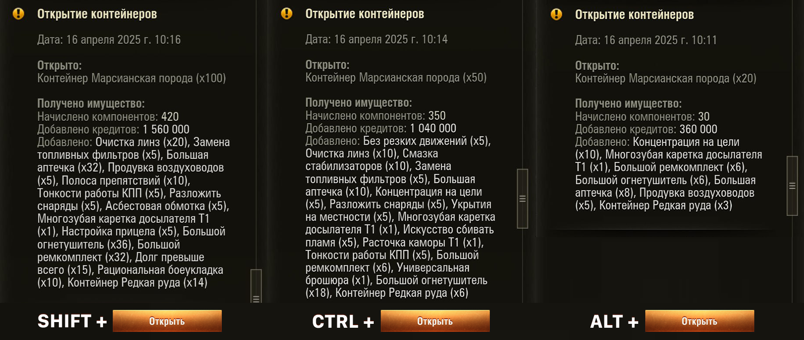

# Множественное открытие контейнеров в игре Мир Танков (Lesta). 

Мод позволяет открывать больше 10 контейнеров за раз.

## Использование 

В хранилище контейнеров выберите `20 шт.`, `50 шт.`, `100 шт.` или `250 шт.` и нажмите `Открыть`. Кнопки доступны, когда в наличии достаточно контейнеров без ключей. Перед открытием 100 или 250 контейнеров через эти кнопки игра попросит подтверждение. При открытии больше 50 контейнеров отображается прогресс, например `Открытие 40/100...`.

Чтобы открыть контейнеры через клавиатурные модификаторы, нажмите кнопку `Открыть`, удерживая нужную клавишу.
- `SHIFT` + `ЛКМ` = открыть 100 контейнеров
- `CTRL` + `ЛКМ` = открыть 50 контейнеров
- `ALT` + `ЛКМ` = открыть 20 контейнеров
- `SHIFT` + `ALT` + `ЛКМ` = открыть 250 контейнеров

## Установка
Поместите мод в папку `mods/<версия игры>` в корневой директории игры. Для кнопок также установите [OpenWG.Gameface 1.2.2](https://gitlab.com/openwg/wot.gameface/-/tags). Клавиатурные модификаторы работают и без этой библиотеки.
